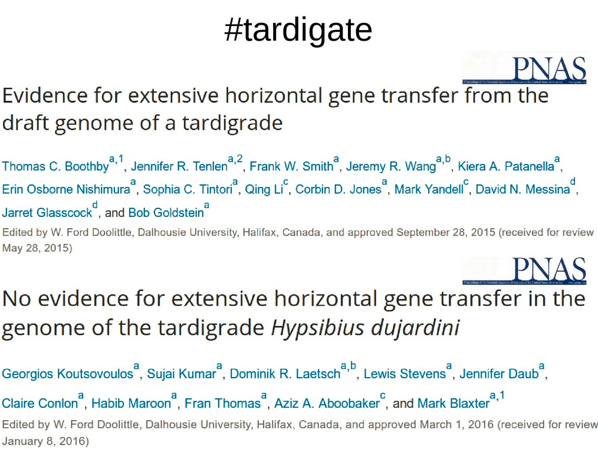

I delivered a lecture in Spanish on tardigrades and bioinformatics in horizontal gene transfer, for an elective course in the Genetics and Biotechnology programme at UNMSM. Materials are available below: slides.

{ width=100% }

Links to materials:

- 🍭 slides: https://bit.ly/tardigate2016
