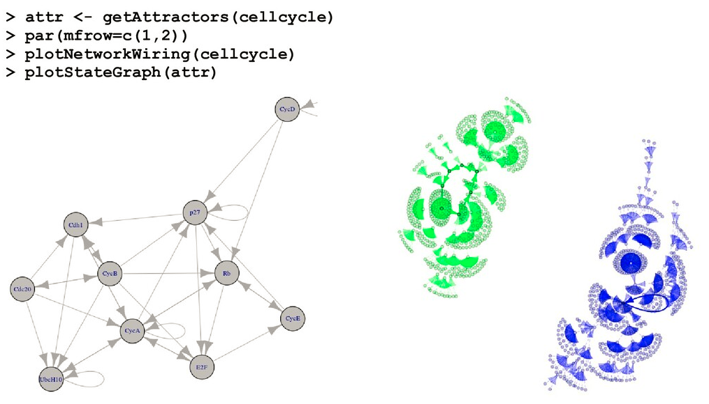

I delivered lectures in Spanish on gene regulatory networks using graph theory and finite automata, for the Biomathematics course at UNMSM (2015-2017). Materials are available below: slides, a tutorial and the code repository.

{ width=100% }

Links to materials:

- 🍭 slides: https://bit.ly/biomath2017_
- ⚒️ tutorial: https://github.com/avallecam/gene_regulatory_networks/blob/main/GRN_py/UNAM_mat2.ipynb
- 🍲 repo: https://github.com/avallecam/gene_regulatory_networks
