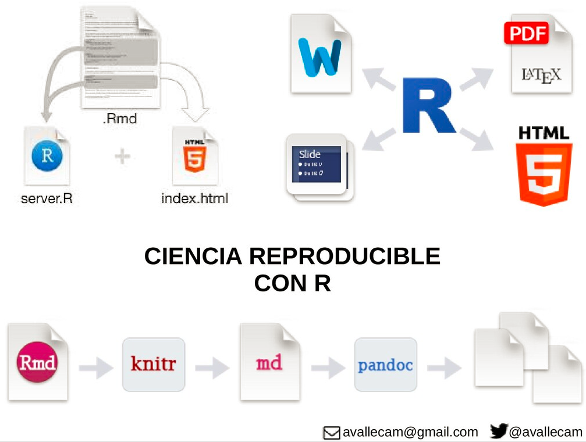

I delivered a workshop in Spanish on reproducible science and microarray analysis, as part of a theory-and-practice Bioinformatics course. Materials are available below: slides, a tutorial and the code repository.

{ width=100% }

Links to materials:

- 🍭 slides: https://bit.ly/reproscience-intro
- ⚒️ tutorial: https://avallecam.github.io/bioinfo2017/biocmicro.nb.html
- 🍲 repo: https://avallecam.github.io/bioinfo2017/
