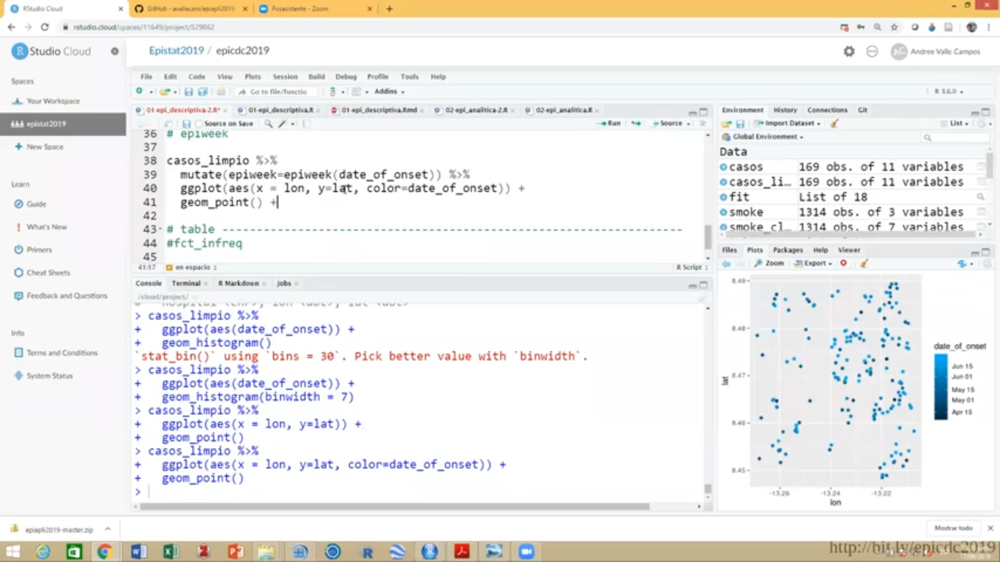

I delivered a talk in Spanish on R applied to epidemiology during the Semana de la Epidemiología (Epidemiology Week), September 2019. Materials are available below: slides, a video recording and the code repository.

{ width=100% }

Links to materials:

- 🍭 slides: https://speakerdeck.com/avallecam/r-aplicado-a-epidemiologia
- 🍿 video: https://youtu.be/C3Yqw883jrs
- 🍲 repo: https://avallecam.github.io/epiapli2019/
