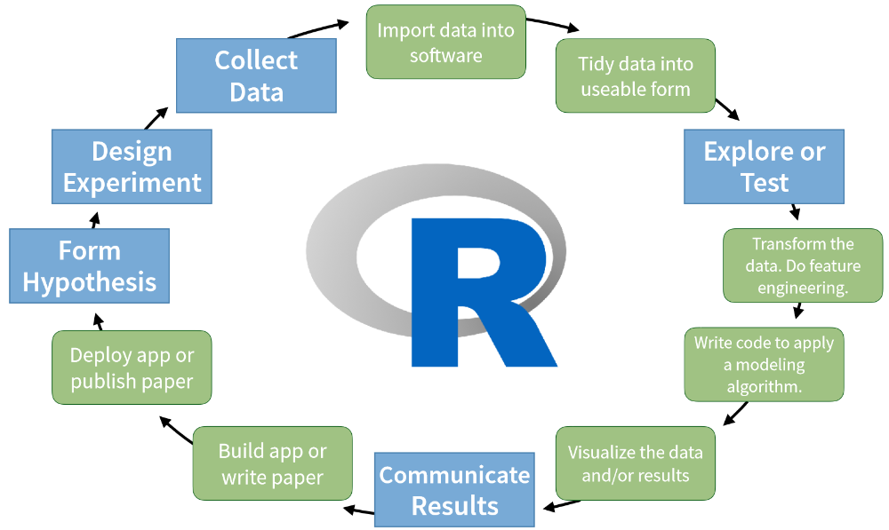

I delivered a talk in Spanish on cdcper, an R package for data reporting and visualization at CDC Peru. Materials are available below: slides.

{ width=100% }

Links to materials:

- 🍭 slides: https://speakerdeck.com/avallecam/cdcper-reporte-y-visualizacion-de-datos-en-cdc-peru-usando-r
