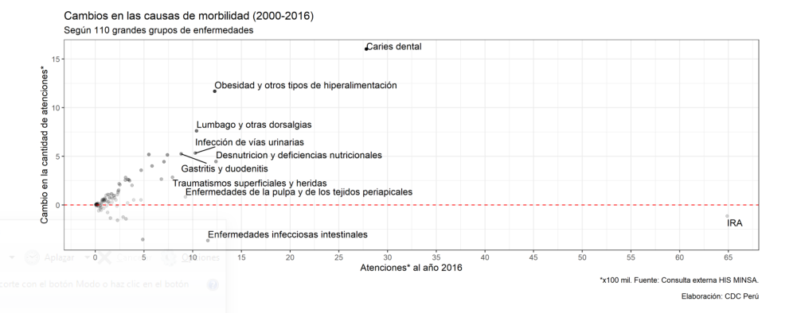

I presented an abstract in Spanish on changes in the morbidity and mortality profiles of Peru (2002-2016), with applications of R and the cdcper package. Materials are available below: the published abstract.

{ width=100% }

Links to materials:

- 🍲 abstract: https://rpmesp.ins.gob.pe/rpmesp/article/view/5178
