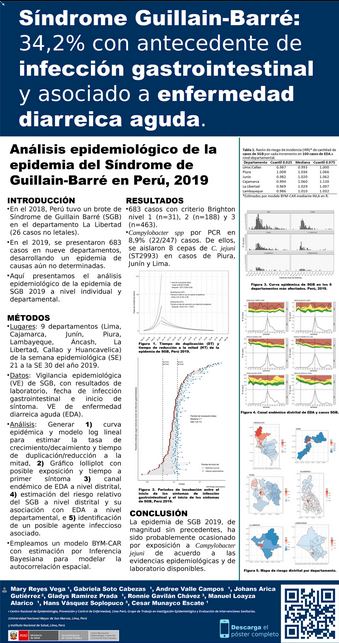

I presented a poster in Spanish on the epidemiological analysis of the Guillain-Barré syndrome epidemic in Peru. Materials are available below: the poster and the code repository.

{ width=30% fig-align="center" }

Links to materials:

- 💾 (better)poster: https://raw.githubusercontent.com/avallecam/cdcperu-gt_investigacion/master/20191120-poster-SGB-INSv3.jpg
- 🍲 repo: https://avallecam.github.io/cdcperu-gt_investigacion/
