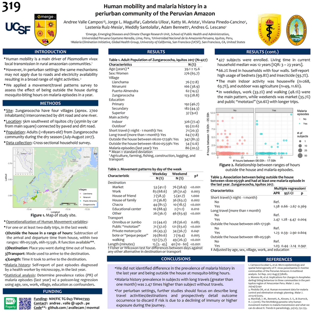

I presented a poster at ASTMH on human mobility and malaria history in a periurban community of the Peruvian Amazon. Materials are available below: the poster and the code repository.

{ width=50% fig-align="center" }

Links to materials:

- 💾 poster: https://raw.githubusercontent.com/avallecam/movmal/master/poster/astmh_poster-ValleAA-20191116.jpg
- 🍲 repo: https://github.com/avallecam/movmal
