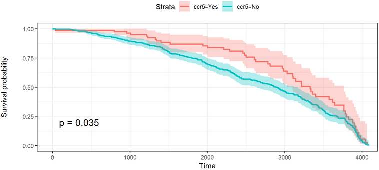

I delivered a workshop in Spanish on epidemiological analysis in R, as part of the course Epidemiological Analysis using R. Materials are available below: slides and the code repository.

{ width=100% }

Links to materials:

- 🍭 slides: https://avallecam.github.io/epistat2019/r02.html
- 🍲 repo: https://avallecam.github.io/epistat2019/
