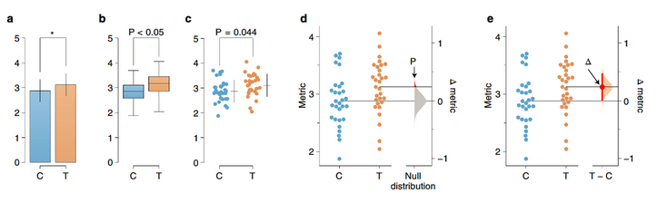

I delivered a workshop in Spanish on inferential statistics in R, as day 1 of an RNA-seq analysis course at CDC Peru. Materials are available below: slides and the code repository.

{ width=100% }

Links to materials:

- 🍭 slides: https://avallecam.github.io/biostat2019/00-biostat2019-slides.html
- 🍲 repo: https://avallecam.github.io/biostat2019/
