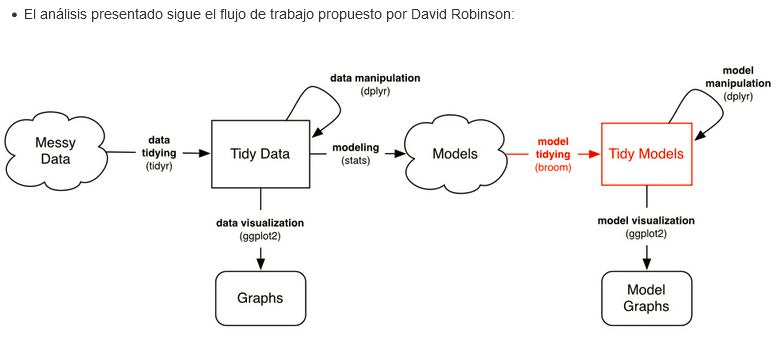

I delivered a workshop in Spanish on microarray analysis with Tidyverse and Bioconductor. Materials are available below: the code repository.

{ width=100% }

Links to materials:

- 🍲 repo: https://github.com/avallecam/bioinfo2019
