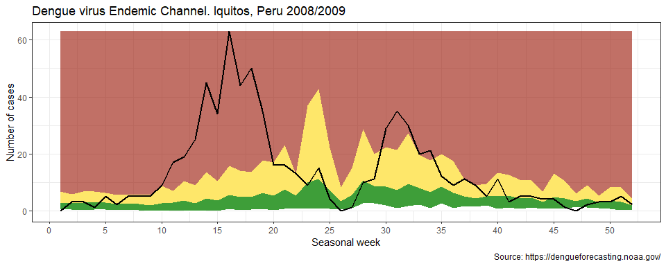

I delivered a lecture in Spanish on algorithms for detecting aberrations in epidemiological surveillance data. Materials are available below: slides and the code repository.

{ width=100% }

Links to materials:

- 🍭 slides: https://avallecam.github.io/episurv2020/0101-surveillance.html
- 🍲 repo: https://github.com/avallecam/episurv2020/blob/main/0101-surveillance.Rmd
