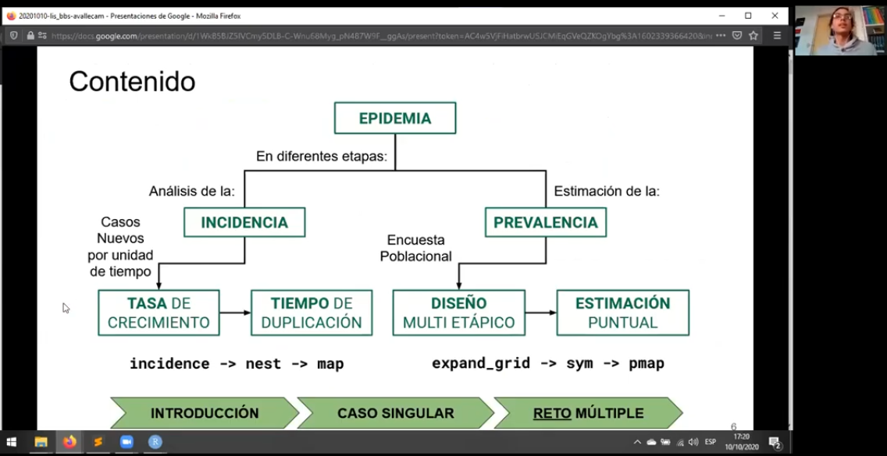

I delivered a talk in Spanish at the Laboratorio de Innovación en Salud (BBS) on analysing multiple epidemics and prevalences with R and purrr. Materials are available below: slides and a video recording.

{ width=100% }

Links to materials:

- 🍭 slides: https://bit.ly/bbslisepi
- 🍿 video: https://youtu.be/mxX8tDmC45E
