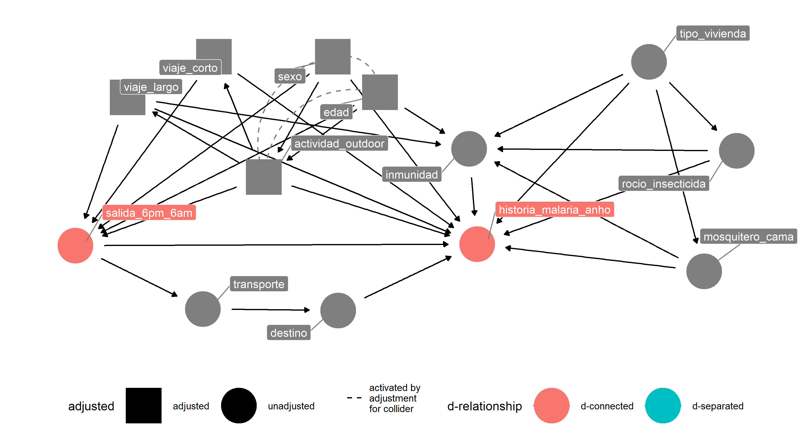

I delivered a talk in Spanish on causal questions for hypothetical interventions. Materials are available below: slides.

{ width=100% }

Links to materials:

- 🍭 slides: https://bit.ly/casual_question
