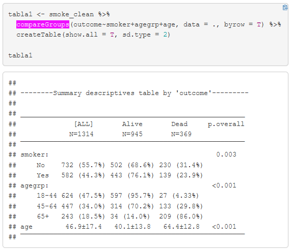

I delivered a lecture in Spanish on data analysis in epidemiological surveillance: person, place, time and the epidemic curve. Materials are available below: a tutorial and an extra tutorial.

{ width=100% }

Links to materials:

- ⚒️ tutorial: https://rpubs.com/avallecam/episurv2021parte1
- ⚒️ extra: endemic channel https://rpubs.com/avallecam/episurv2021
