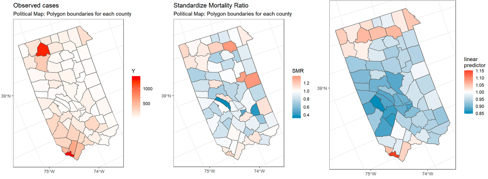

I delivered a lecture in Spanish on data analysis in epidemiological surveillance, focused on spatial analysis. Materials are available below: slides and a tutorial.

{ width=100% }

Links to materials:

- 🍭 slides: http://bit.ly/episurv2021parte2
- ⚒️ tutorial: https://rpubs.com/avallecam/episurv2021parte2
