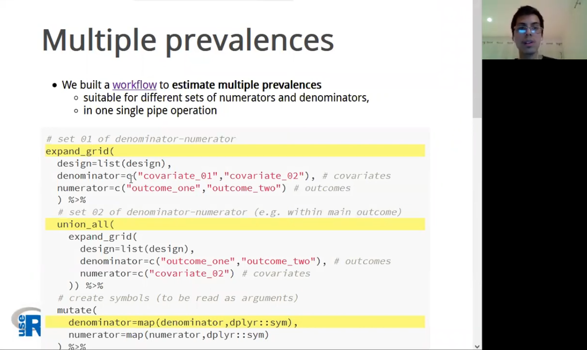

I delivered a talk at useR! 2021 on serosurvey, an R package for serological surveys and prevalence estimation under misclassification. Materials are available below: slides, a video recording and the code repository.

{ width=100% }

Links to materials:

- 🍭 slides: https://bit.ly/serosurvey-user21
- 🍿 video: https://youtu.be/0mugb1mE68g
- 🍲 repo: https://github.com/avallecam/serosurvey-user21
