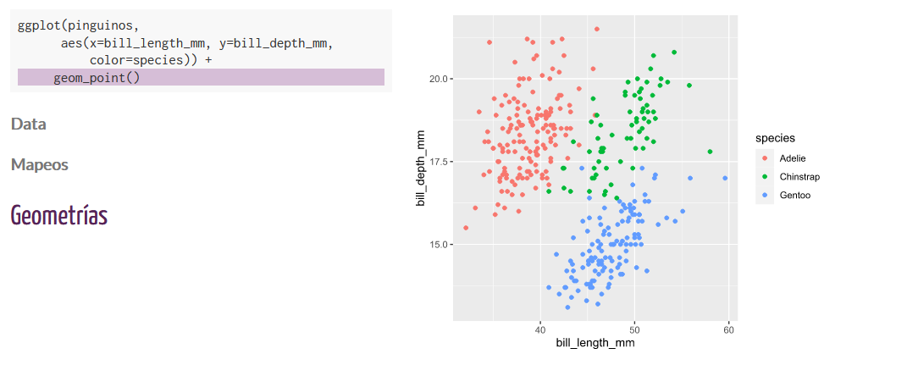

I delivered a workshop in Spanish introducing data visualization with ggplot2. Materials are available below: slides, a video recording and the code repository.

{ width=100% }

Links to materials:

- 🍭 slides: https://bit.ly/r08ggplot2
- 🍿 video: https://youtu.be/waE31-OG8Ho
- 🍲 repo: https://github.com/avallecam/workshop_ggplot2
