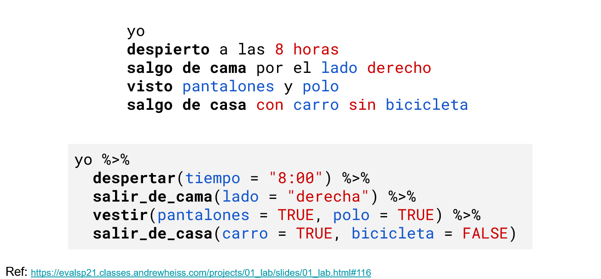

I delivered a workshop in Spanish introducing R and RStudio, using an introductory practical from RECON learn. Materials are available below: slides and a tutorial.

{ width=100% }

Links to materials:

- 🍭 slides: https://bit.ly/cursoepidemia-intror
- ⚒️ tutorial: https://www.reconlearn.org/post/practical-intror-spanish.html
