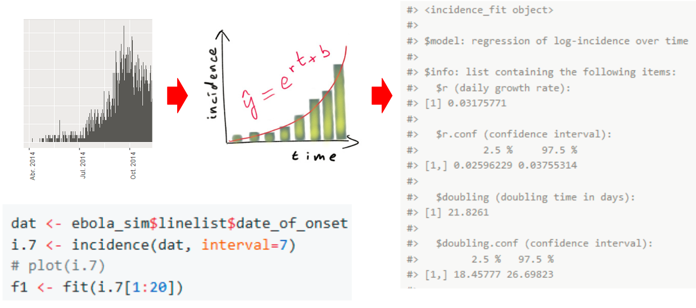

I delivered a workshop in Spanish introducing the statistical analysis of epidemics, using real-time outbreak response practicals from RECON learn. Materials are available below: slides and a tutorial.

{ width=100% }

Links to materials:

- 🍭 slides: https://bit.ly/cursoepidemias-analisisbrote
- ⚒️ tutorial: https://www.reconlearn.org/post/real-time-response-1-spanish.html
