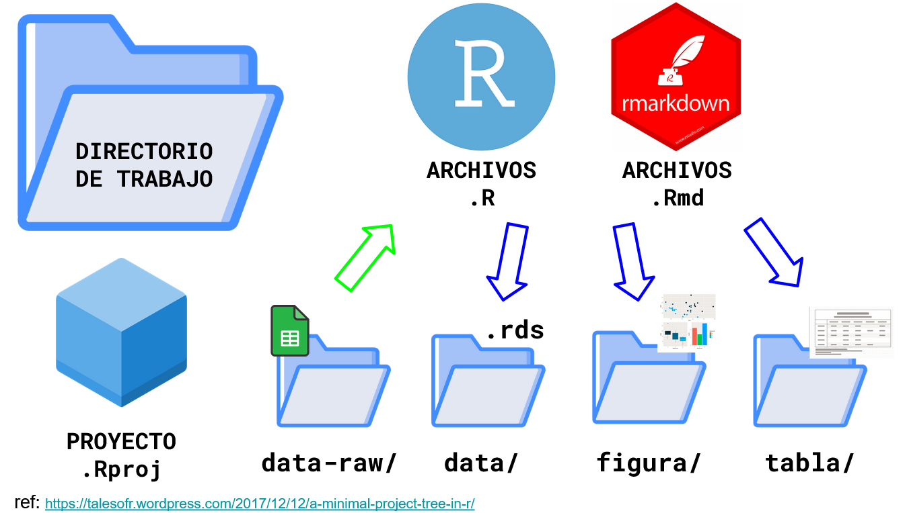

I delivered a workshop in Spanish on project management with R projects, as part of the CDC Peru introductory R course. Materials are available below: slides and the code repository.

{ width=100% }

Links to materials:

- 🍭 slides: https://bit.ly/r02proyectos
- 🍲 repo: https://cdcperucursos.github.io/cursorcdc1.html
