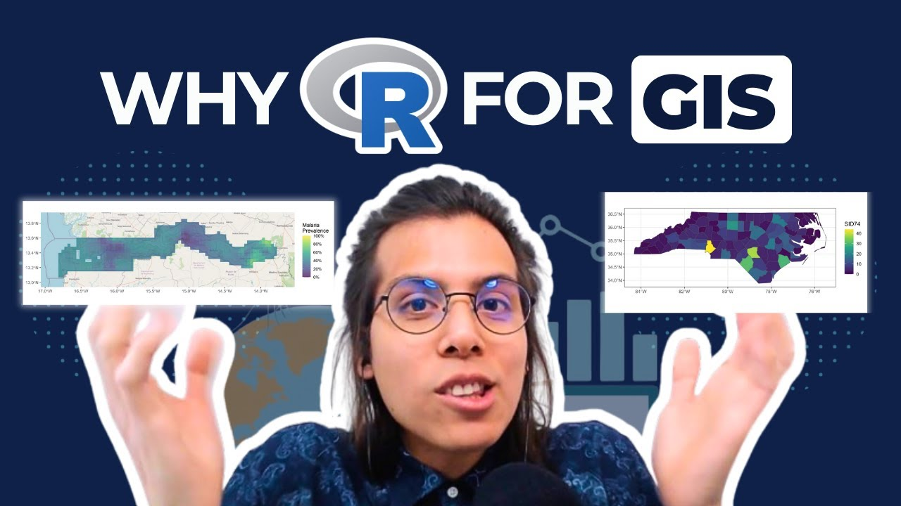

I authored and presented a lesson on geospatial visualization in R for The GRAPH Courses. It covers data manipulation and mapping with {ggplot2} and {sf}: thematic and density maps, shapefiles, country and administrative boundaries with {geoboundaries}, physical features (roads, rivers, buildings), labels, scales and north arrows, and reproducible GIS workflows. Materials are available below: course page and video playlist.

{ width=100% }

Links to materials:

- 📚 course: https://thegraphcourses.org/courses/geospatial-viz/
- 📺 video playlist (7 videos): https://www.youtube.com/playlist?list=PLkkleDPMR2sUBWvaj6tqd69tWbX7XBghh
