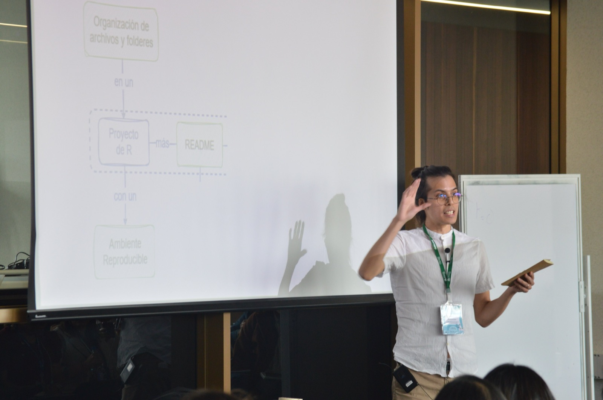

I delivered a talk in Spanish at the International Course on Outbreak Analytics and Modelling in Public Health (EpiModelac 2023) in Bogotá, Colombia, led by Pontificia Universidad Javeriana as part of Epiverse-TRACE LAC. On the second day of the course, on statistics and methods for outbreak response, I presented good practices for reproducible, open and sustainable analysis in outbreak and epidemic response. Materials are available below: tutorial and course website.

{ width=100% }

Links to materials:

- 📘 tutorial: https://epiverse-trace.github.io/research-compendium/
- 🏫 course: https://epiverse-trace.github.io/epimodelac/
- 💬 Epiverse-TRACE post: https://x.com/Epiverse_TRACE/status/1732870364248654020
