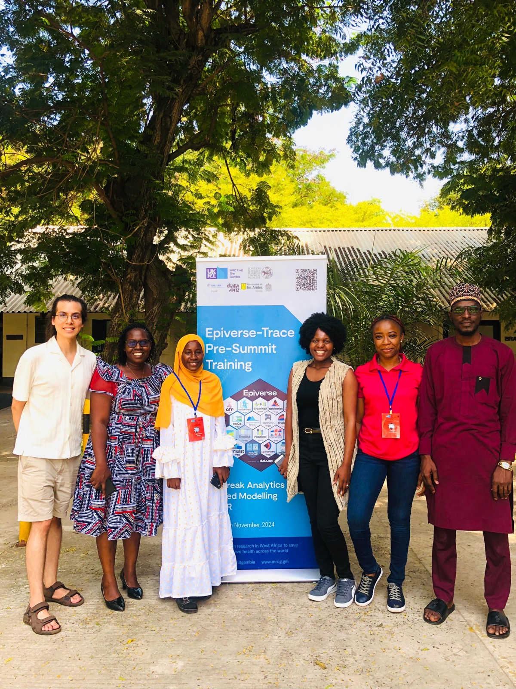

I was the lead instructor of the Epiverse-TRACE pre-summit training "Outbreak Analytics and Applied Modelling with R", the initiative's first training course in Africa. It was held at the MRC Unit The Gambia at LSHTM (Fajara) from 25 to 29 November 2024, ahead of the third annual Epiverse-TRACE summit, and was facilitated by Epiverse-TRACE members from MRCG, LSHTM and Pontificia Universidad Javeriana. Over five days, participants simulated transmission and interventions, cleaned and visualized outbreak case data, accessed delay distributions, estimated transmission metrics, forecasts, severity and superspreading, and presented their own outbreak data challenges. Materials are available below: training report (with a photo of all participants), course page and news.

{ width=60% }

Links to materials:

- 📄 training report: https://doi.org/10.5281/zenodo.14946723
- 🏫 course page: https://epiverse-trace.github.io/gam-summit/pre-training.html
- 📰 LSHTM news: https://www.lshtm.ac.uk/research/units/mrc-gambia/news/444596/mrcg-lshtm-hosts-3rd-annual-epiverse-summit
