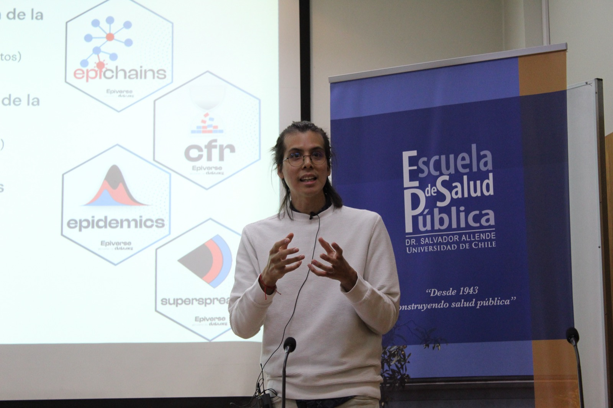

After the seminar and workshop at the School of Public Health, Universidad de Chile, I answered four questions in Spanish on how to make data analysis projects more reproducible. I recommended three practices: the {rcompendium} package to structure a project, {renv} to record package versions, and a README that says what the analysis does and how to reuse it. We also discussed sharing analysis code when the data are restricted, and what limits data interoperability between public and private systems.

Thanks to the Public Health Data Science Group and the School of Public Health for the invitation. I also learned about the transdisciplinary approach of the school and the Faculty of Medicine.

{ width=100% }

Links to materials:

- 📰 interview: https://saludpublica.uchile.cl/noticias/227671
- 💬 LinkedIn post: https://www.linkedin.com/posts/avallecam_cuatro-reproducibilidad-transdisciplinar-activity-7323522611882127361-CmhM
