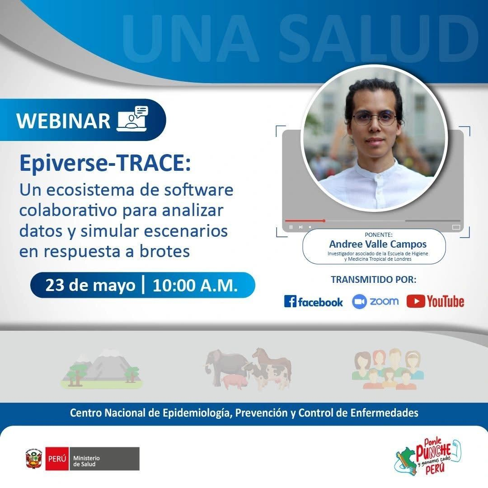

I delivered a webinar in Spanish at the invitation of CDC Peru and the Peruvian Ministry of Health. The talk had two parts:

- An introduction to the software gap that [Epiverse-TRACE](https://epiverse-trace.github.io/) fills, how to learn it, and why we use GitHub.
- A live-coding demo covering data cleaning and validation, epidemic curves, time-adjusted case fatality risk, and individual transmission variability (superspreading) for contact tracing. It showed how new and existing R packages work together with the tidyverse: {cleanepi}, {linelist}, {incidence2}, {cfr}, {epiparameter}, {epicontacts}, {fitdistrplus} and {superspreading}.

{ width=60% }

Links to materials:

- 📺 recording (Facebook): https://www.facebook.com/cdcperuminsa/videos/webinar-epiverse-trace-un-ecosistema-de-software-colaborativo-para-analizar-dato/1249834916760814/
- 👥 Epiverse-TRACE: https://epiverse-trace.github.io/people.html
- 💬 LinkedIn post: https://www.linkedin.com/posts/avallecam_cdcper%C3%BA-livecoding-interoperabilidad-activity-7332170588435664896-6leK
