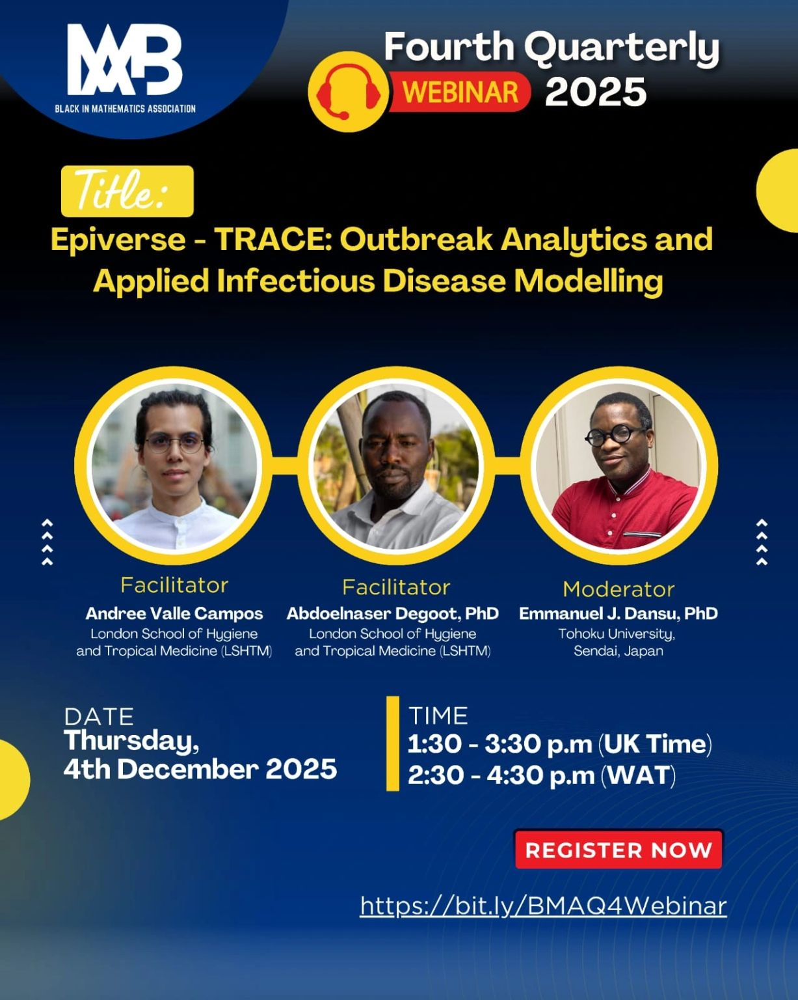

Together with Abdoelnaser Degoot, and moderated by Emmanuel J. Dansu, I delivered the fourth quarterly 2025 webinar of the Black in Mathematics Association (BMA). We introduced [Epiverse-TRACE](https://epiverse-trace.github.io/) and the gap it fills in the R ecosystem for outbreak response. We then live-coded an SEIR-V model to show how packages work together: {epidemics}, {EpiEstim}, {epiparameter} and {socialmixr}. Materials are available below: recording, with resources in the video description.

{ width=60% }

Links to materials:

- 📺 recording: https://www.youtube.com/watch?v=FSsXIBG_nwI
- 💬 Epiverse-TRACE LinkedIn post: https://www.linkedin.com/posts/epiverse-trace_bma-q4webinar-25-epiverse-trace-for-outbreak-activity-7404155372695064576-NzXA
