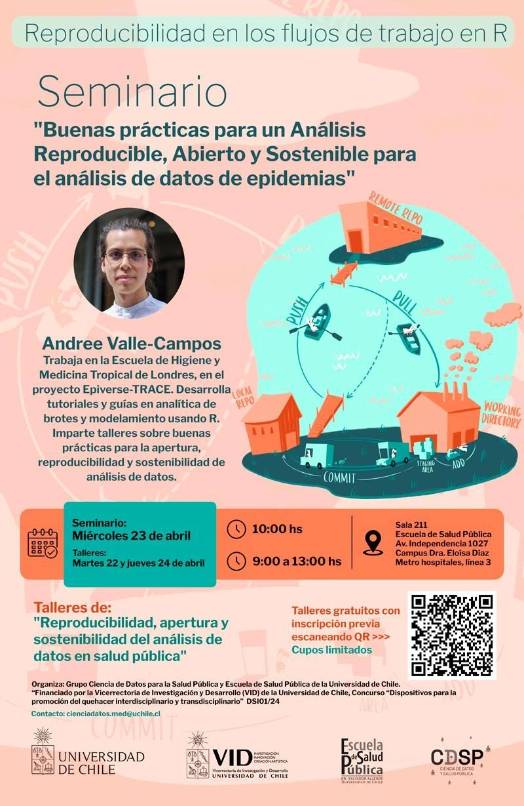

I delivered a seminar in Spanish at the School of Public Health, Universidad de Chile, in Santiago, hosted by the Public Health Data Science Group (CDSP). It answered three questions: why use Git, what version control is, and how to use it in epidemiology. It focused on reproducible, sustainable and open practices that are quick to learn and pay off once mastered, for software used in research and outbreak response. Around the seminar, I also led a hands-on R workshop on 22 and 24 April. Materials are available below: recordings.

{ width=60% }

Links to materials:

- 📺 seminar recording: https://www.youtube.com/live/dCvWvT8azRg
- 📺 workshop recordings: https://www.youtube.com/live/qIx9cizVeTE and https://www.youtube.com/live/y57VHe9MrF8
- 📅 event page: https://saludpublica.uchile.cl/agenda/225936/seminario-buenas-practicas-para-un-analisis-reproducible
- 💬 LinkedIn post: https://www.linkedin.com/posts/avallecam_por-qu%C3%A9-usar-git-qu%C3%A9-es-el-control-de-activity-7319058042501709824-11vS
