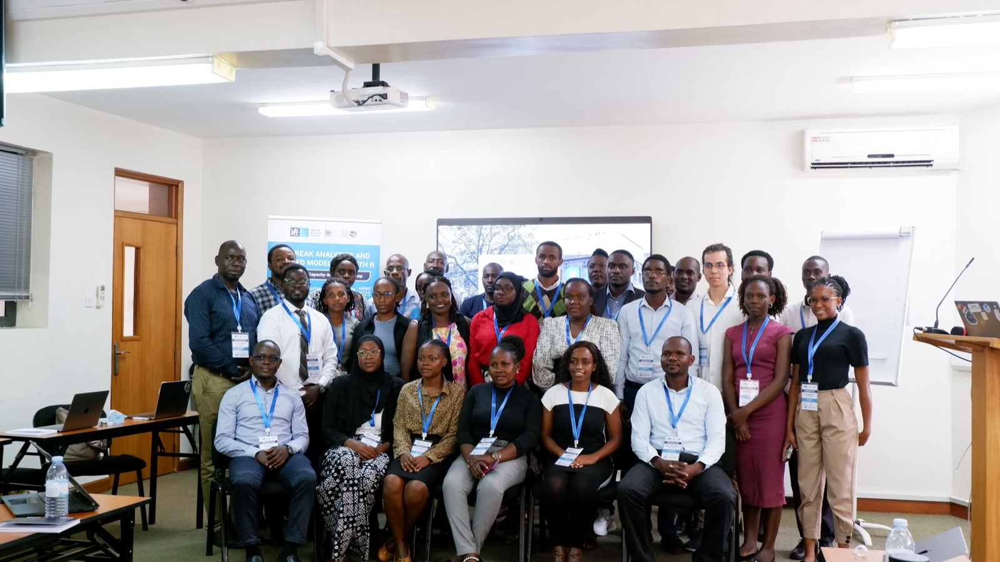

I was the lead instructor of a two-week, hands-on capacity-building workshop on outbreak analytics and applied modelling with R, hosted by the MRC/UVRI & LSHTM Uganda Research Unit in Entebbe, Uganda, from 11 to 22 August 2025. Participants used Epiverse-TRACE tools to investigate and respond to disease outbreaks. Materials are available below: tutorials.

{ width=100% }

Links to materials:

- 📘 tutorials: https://epiverse-trace.github.io/learn
- 💬 MRC Uganda call for applications: https://x.com/MRC_Uganda/status/1932699086987071498
