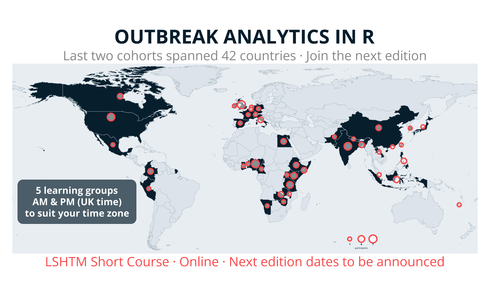

I designed and organised the first two editions (2025 and 2026) of the online [Outbreak Analytics and Applied Modelling in R](https://www.lshtm.ac.uk/study/courses/short-courses/outbreaks-analytics-R) short course at the London School of Hygiene & Tropical Medicine (LSHTM). These two cohorts brought together participants from 42 countries, learning in five groups with morning and afternoon (UK time) sessions to suit every time zone. Participants use Epiverse-TRACE tools to analyse outbreak data and build applied models in R. Dates for the next edition will be announced soon.

A big thank you to all my LSHTM colleagues and to every student who trusted us with their learning. 🙏

{ width=100% }

Links to materials:

- 🎓 course page: https://www.lshtm.ac.uk/study/courses/short-courses/outbreaks-analytics-R
- 📘 tutorials: https://epiverse-trace.github.io/learn
